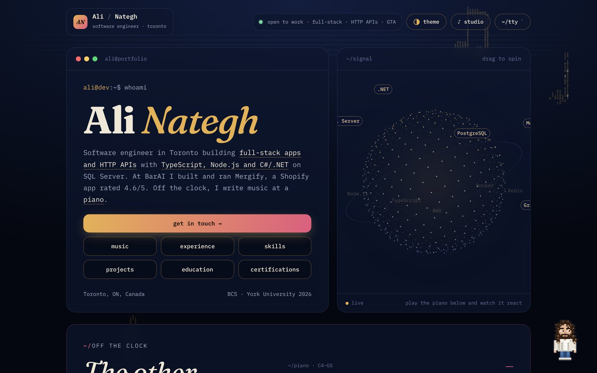
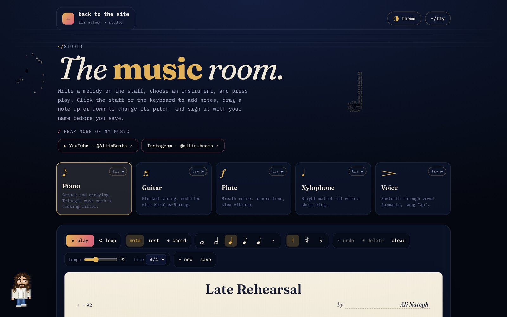
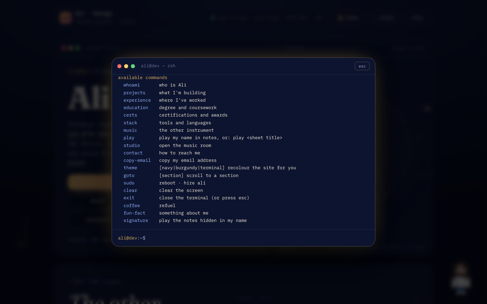
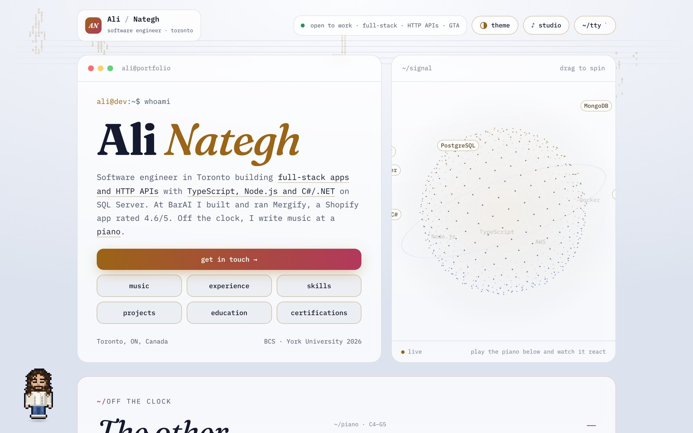
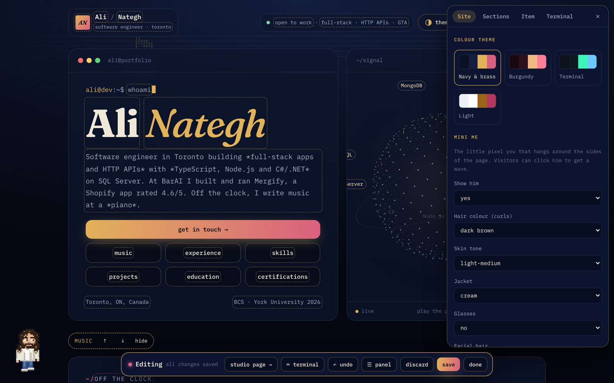
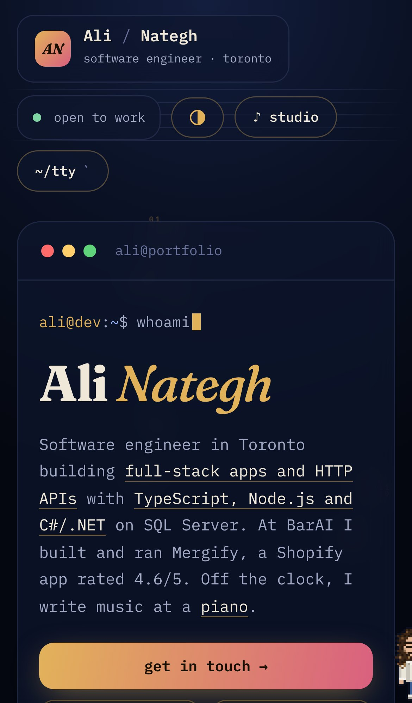

<div align="center">


# alinategh.com

**My portfolio. It looks like a concert hall after dark and it has a working piano in it.**

Plain HTML, CSS and JavaScript. No framework, no build step, no dependencies.

[Live site](https://alinategh.com) · [LinkedIn](https://www.linkedin.com/in/alinategh) · [GitHub](https://github.com/Ali-Nategh)



</div>

---

## What's on the page

| | |
|---|---|
| **Hero and signal sphere** | A terminal-style intro card next to a draggable 3D sphere of points with my stack orbiting it. The sphere pulses whenever a piano note is played. |
| **Music, first** | A playable piano right on the page (mouse, touch, or the `A`–`'` keys on your keyboard), my instruments and years, and links to my music. |
| **Experience, skills, projects, education, certifications** | All driven by one content file, so I can reorder, hide or rewrite any section without touching code. |
| **The studio** (`#studio`) | A small sheet-music editor: write notes and chords on a staff, choose one of five synth voices, play it back and save it. |
| **The terminal** (`` ` `` key) | A fake zsh with real commands (`whoami`, `projects`, `goto music`, `theme light`, `sudo reboot`…) plus my own custom commands. |
| **Themes** | Navy & brass (default), Burgundy, Terminal and Light. Visitors pick one from the top bar and their browser remembers it. |
| **Mini Ali** | A pixel-art me who lives at the edge of the page and gets up to things. Click him and he waves. |
| **Binary notes** | Faint musical notes in the background that assemble out of `0`s and `1`s, hold for a moment, then dissolve. |
| **In-page editor** (`#admin`) | Click any text on the page to edit it, then use the side panel for everything else. Export the result as `content.json`. |

<table>
<tr>
<td width="50%"></td>
<td width="50%"></td>
</tr>
<tr>
<td></td>
<td></td>
</tr>
</table>

<p align="center"></p>

---

## Stack

| Layer | What | Why |
|---|---|---|
| Markup / style | Semantic HTML, modern CSS (custom properties, grid, `clamp()`, `backdrop-filter`) | Four themes are just four sets of CSS variables |
| Behaviour | Vanilla JavaScript (ES2020+), no libraries | Everything here is small enough not to need a framework, and the page loads instantly |
| Graphics | Canvas 2D (sphere, binary notes, mini Ali), inline SVG (staff notation, icons) | Full control over every pixel, and it stays sharp at any size |
| Audio | Web Audio API: oscillators, filters, Karplus–Strong, a generated convolution reverb | Five instruments with zero audio files |
| Fonts | [Fraunces](https://fonts.google.com/specimen/Fraunces), [IBM Plex Mono](https://fonts.google.com/specimen/IBM+Plex+Mono), [Noto Music](https://fonts.google.com/noto/specimen/Noto+Music) from Google Fonts | A serif with character, a mono for the terminal look, and real music glyphs |
| Content | `content.json` plus a typed default in `js/app.js` | A one-file CMS with no database |
| Hosting | Any static host. Included: nginx in Docker with gzip, caching and security headers | Runs anywhere, from a $0 VPS to GitHub Pages |
| Assets | Python + Pillow scripts in `tools/` | The favicons and the link-preview image are generated, not hand-drawn |

---

## How the features work

<details>
<summary><b>Content model and the in-page editor</b></summary>

Everything the home page and studio show lives in one object, `C`. The default copy (`DEFAULT` in `js/app.js`) is merged with `content.json` when the page loads, and `render()` builds every section from the merged object.

- Every editable piece of text has a `data-edit="path.to.field"` attribute. In edit mode those elements become `contentEditable`, and on `input` the new text is written back to that path in `C`.
- Lists (experience bullets, projects, courses, links) get small ↑ ↓ ✕ tool buttons and a "+ add" card. The side panel (**Site · Sections · Item · Terminal**) covers what can't be clicked: section order and visibility, theme, tab icon, mini-Ali settings, terminal commands and so on.
- Undo is a stack of JSON snapshots, capped at 60.
- **Save** keeps a draft in `localStorage`, and **Export** downloads `content.json`. Put that file next to `index.html` and every visitor sees the new version.
- The server's `content.json` always wins. A browser draft is only shown while it is still based on the `content.json` the server is serving; upload a different file and the draft is set aside (with a one-click *restore*). Once the exported file is live, the matching draft is cleared automatically.
- The editor waits for `content.json` before opening, so it never starts from the built-in defaults. If the file can't load (a 404, or the page opened as `file://`), the console and the editor say so.

The editor only ever changes the editing person's own browser, so it can be left open on the live site without risk. To lock it to `localhost` or turn it off, change one line at the top of the editor code:

```js
const EDITOR = 'anywhere'; // 'anywhere' | 'localhost' | 'off'
```

</details>

<details>
<summary><b>Themes</b></summary>

Each palette is a block of CSS custom properties under `:root[data-palette="…"]`, covering background, panels, lines, text, accent, claret, the cool accent and the "sunk" surfaces. Switching the theme only changes one attribute on `<html>`. The canvases (sphere, binary notes, mini Ali) re-read their colours whenever `data-palette` changes, using a `MutationObserver`.

The site owner sets the default theme in the editor. A visitor's choice is stored under `an.theme` and overrides that default for them only. The toggle icon is a small SVG half-circle, so it stays smooth at any zoom.

</details>

<details>
<summary><b>The signal sphere</b></summary>

760 points (420 on phones) are spread evenly over a sphere with a Fibonacci lattice, rotated in 3D, projected to 2D, and drawn back to front with depth-based size and opacity. Tags orbit on a tilted ring and are drawn as pills in the panel colour. It leans toward your cursor, and you can drag to spin it; it keeps spinning with inertia.

Playing a note sends a "kick" that briefly swells the sphere and brightens it. Resizing is debounced with `requestAnimationFrame` and only redraws when the size actually changed, which also avoids the classic `ResizeObserver loop` warning.

</details>

<details>
<summary><b>Five synth voices, no samples</b></summary>

All sound is generated live with the Web Audio API:

| Voice | Technique |
|---|---|
| Piano | Triangle plus a sine an octave up, a fast attack, a two-stage decay, and a low-pass filter that closes as the note fades |
| Guitar | Karplus–Strong plucked string: a short noise burst fed through a tuned feedback delay |
| Flute | A sine with breath noise through a band-pass filter, plus a slow vibrato |
| Xylophone | Inharmonic partials with very short decays |
| Voice | A sawtooth through three formant band-pass filters (an "ah" vowel) with vibrato |

Everything goes through a convolution reverb whose impulse response is generated in code from decaying noise. Playback is scheduled on the `AudioContext` clock rather than with `setTimeout`, so tempo stays steady even when the tab is busy.

</details>

<details>
<summary><b>The studio: staff notation and chords</b></summary>

A sheet is a list of events. Each event is `{ k: [{ s, a }], d, dot }`, where `s` is the staff step, `a` the accidental, `d` the duration and `dot` marks a dotted note. A rest is `{ r: true, d }`. Chords are simply events with more than one key.

- **Engraving.** The staff is drawn as SVG: clef, time signature, note heads, stems, flags, ledger lines, accidentals, dots, bar lines and rests. The treble clef is placed by measuring its real glyph with `getBBox()`, so its curl sits on the G line in every font.
- **Input.** Click the staff, the on-screen keyboard, or your computer keyboard: `A`–`'` for white notes, `W E T Y U O P` for black, `1`–`5` for durations, `.` to dot, `R` for a rest, and `C` or Shift for chords.
- **Library.** The built-in sheets are written in a compact notation, for example `P("q:C4+E4+G4 e.:A#4 h:r")`. The library has developer jingles (*Deploy Succeeded*, *Build Failed*, *404*, *Merge Conflict*, *Power On / Off*) and public-domain openings (Beethoven, Satie, Grieg, Joplin).
- **Saving.** Visitors' sheets are saved in their own browser. The owner can promote a sheet to the library or to the example sheet from the editor.

</details>

<details>
<summary><b>The terminal</b></summary>

Press `` ` `` or click **~/tty**. It has command history (↑ ↓) and accepts both built-in and custom commands:

- **Built-in:** `help`, `whoami`, `projects`, `experience`, `education`, `certs`, `stack`, `music`, `play [sheet]`, `studio`, `contact`, `copy-email`, `theme <name>`, `goto <section>`, `ls`, `cat`, `date`, `echo`, `clear`, `exit`, `sudo …`
- **Custom:** commands defined in `content.json` (editable from the editor's Terminal tab). Each one prints text and can optionally trigger an action: play a sheet, open a section, switch theme or open a link. The defaults are `coffee`, `fun-fact` and `signature`.

</details>

<details>
<summary><b>Binary notes background</b></summary>

A random note glyph (♪ ♫ ♩ ♬ 𝄞) is drawn once onto an offscreen canvas and sampled on a 6 px grid. Each inked cell becomes one character, `0` or `1`. Every cell gets its own appear time, flip rate and fade-out time, so the note seems to *compile* into place and then decay.

At most 5 notes are on screen at once (3 on phones), positioned so they don't overlap, and the loop runs at about 30 fps. They use the theme's accent colour. The background is skipped entirely when the visitor has `prefers-reduced-motion` turned on.

</details>

<details>
<summary><b>Mini Ali</b></summary>

A 61 × 46 pixel character drawn into a pixel buffer. A black outline is computed automatically around any filled cell, and the sprite is mirrored to face left or right. Hair is built from a small curl tile, and only the lower curls bounce, with a sway that follows his movement. His eyes are three cells wide, so a one-cell pupil shift reads as a glance.

His behaviour is a list of **activities**, each made of **phases** (frames, frame time, repeats, movement):

- **Desktop:** he idles in the side gutter, walks to the other side, peeks around the edge, sits down with headphones and a vinyl, does push-ups or codes on a laptop.
- **Phones:** he peeks in from the edge and every 10–15 s *visits*, stepping onto the page to do an activity before slipping back.
- **Click him:** phases marked `skip` are dropped, phases marked `loopFinish` finish their current cycle, and then he waves.

His hair, skin, jacket, glasses and beard can be changed from the editor (`C.mini`). There's also a console easter egg: `miniAli.wave()` or `miniAli.do('pushups')`.

</details>

<details>
<summary><b>Accessibility, performance and SEO</b></summary>

- **Accessibility:** semantic landmarks, labelled controls, `aria-pressed` toggles, a keyboard-navigable theme menu (`menuitemradio`), and visible focus rings. The terminal is a labelled modal dialog. All animations respect `prefers-reduced-motion`.
- **Performance:** the canvases pause when the tab is hidden, the background runs at a capped frame rate, resize work is debounced, and nothing loads apart from the fonts. All the HTML, CSS and JS together come to about 65 KB gzipped.
- **SEO:** a meta description, a canonical URL, Open Graph and Twitter cards with a generated 1200 × 630 preview image, `schema.org/Person` JSON-LD, `robots.txt` and `sitemap.xml`.

</details>

---

## Project structure

```
.
├── index.html            markup and meta tags
├── content.json          the site's content (export from the editor, or edit by hand)
├── css/
│   ├── main.css          layout, themes, components, studio, editor
│   └── mini.css          mini Ali's canvas
├── js/
│   ├── app.js            content model, render, editor, themes, sphere, synths, studio, terminal
│   ├── bitnotes.js       binary-note background
│   └── mini.js           mini Ali
├── assets/
│   ├── icons/            calligraphic-A tab icons (gray, brass, blend)
│   └── og-image.jpg      link-preview card
├── favicon.ico
├── robots.txt · sitemap.xml
├── deploy/               nginx config + security headers
├── docker-compose.yml
├── tools/                asset and screenshot scripts
└── docs/                 README screenshots
```

---

## Run it locally

Any static server works, because the page fetches `content.json` (opening the file directly with `file://` blocks that fetch):

```bash
git clone https://github.com/Ali-Nategh/alinategh.com.git
cd alinategh.com
python3 -m http.server 8000      # or: npx serve .
```

Then open <http://localhost:8000>, and <http://localhost:8000/#admin> to edit.

## Deploy

**Docker + nginx** (what I use on a small VPS):

```bash
docker compose up -d             # serves on :8080; put Caddy or Certbot in front for HTTPS
```

The nginx config compresses text, makes browsers revalidate `index.html`, `content.json`, CSS and JS on every visit (so a deploy shows up immediately), caches images for a month, adds security headers, and refuses to serve `tools/`, `deploy/`, `docs/` and the README.

**GitHub Pages / Netlify / Cloudflare Pages:** point them at the repo root. No build command is needed.

**Updating content:** open `#admin`, make your changes, press **save**, then **export content.json**. Then commit the file, or copy it to the server:

```bash
scp content.json user@server:~/site/
```

---

## Regenerating assets

```bash
pip install pillow fonttools brotli
python3 tools/make_favicons.py   # assets/icons/*, favicon.ico   (needs tools/fonts/pinyon-script.ttf)
python3 tools/make_og.py         # assets/og-image.jpg            (needs the fontsource packages, see the script header)
node tools/screenshots.js        # docs/*.png                     (needs Playwright and a local server)
```

---

## Easter eggs

- `sudo reboot` in the terminal plays a boot chime written for the site
- `sudo hire ali`
- `signature` plays the notes hidden in my name: **A · E · G · H** (H is B in German notation)
- Click mini Ali. On desktop, wait and watch what he gets up to
- Open the console and run `miniAli.do('music')`

---

## How it was built

I built this site by prompt engineering it with Claude (Anthropic) as my AI pair programmer. I set the direction, the taste and the constraints, and reviewed, tested and iterated on every feature. Claude did most of the typing. The commit history and this README are the honest record of that.

## Credits

- Fonts: Fraunces, IBM Plex Mono, Noto Music and Pinyon Script (logo), all under the SIL Open Font License.
- Library pieces by Beethoven, Satie, Grieg and Joplin are in the public domain. The developer jingles and *Signature* are original.
- Inspired by the many award-winning portfolios that treat a personal site as a small product.

## License

The code is under the [MIT license](LICENSE). The personal content is not: my bio, experience, compositions, the mini-Ali likeness, the logo and the preview image. If you fork this, make it yours.
